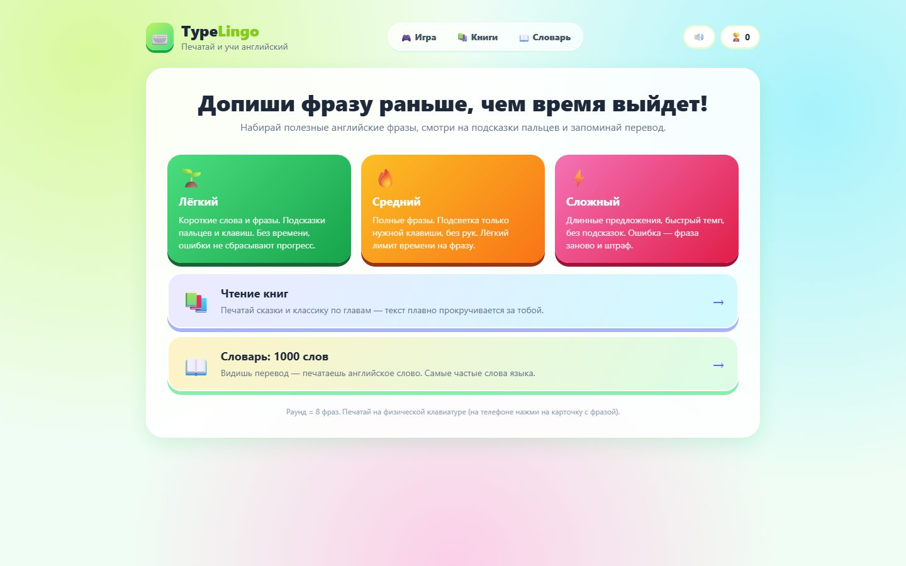
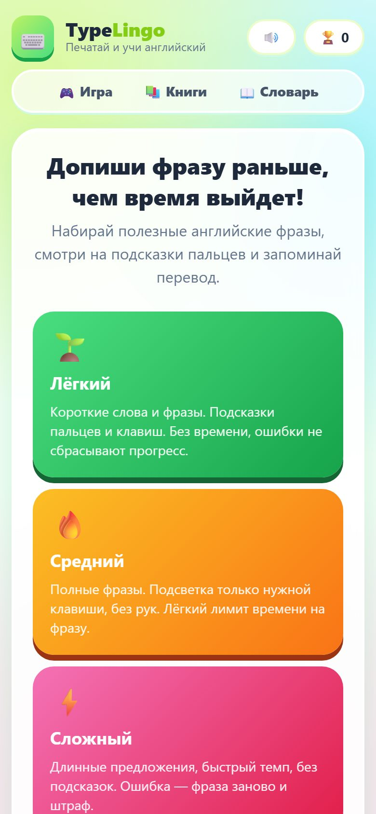

# TypeLingo — Learn English by Touch Typing

A browser game for Russian speakers that combines touch-typing practice with English: you type useful English phrases against the clock, see which finger to use, and remember the translation along the way.

**Play:** https://typelingo-production.up.railway.app

<p>
  
  
</p>

## Features

- **Three difficulty levels**
  - *Easy* — short words and phrases, finger and key hints, no timer, mistakes don't reset progress
  - *Medium* — full phrases, only the next key is highlighted, a soft time limit per phrase
  - *Hard* — long sentences, fast pace, no hints; a mistake restarts the phrase with a penalty
- **Book reading** — type fairy tales and classics chapter by chapter while the text scrolls with you
- **Vocabulary trainer** — 1000 most frequent English words: see the translation, type the word
- **Pronunciation** via the Web Speech API, sound effects via Web Audio
- Progress and score saved in the browser (`localStorage`); works on phones by tapping the phrase card

## Tech

Vanilla JavaScript, HTML and CSS — no framework, no build step (~3,400 lines). Served by **nginx** in a Docker container on Railway.

```
site/
├── index.html
├── app.js       Game logic: modes, timer, keyboard and finger hints, scoring
├── phrases.js   Phrase sets per difficulty
├── books.js     Texts for the reading mode
├── vocab.js     1000-word dictionary
└── style.css
Dockerfile           nginx:alpine serving site/
nginx.conf.template  Listens on $PORT (Railway)
```

## Run locally

Open `site/index.html` in a browser, or:

```bash
docker build -t typelingo . && docker run -p 8080:8080 typelingo
```
